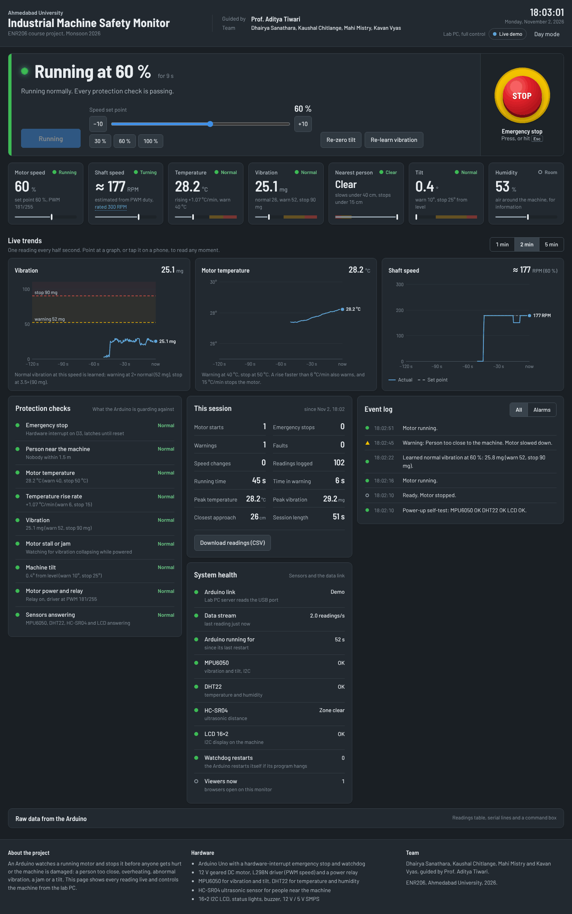
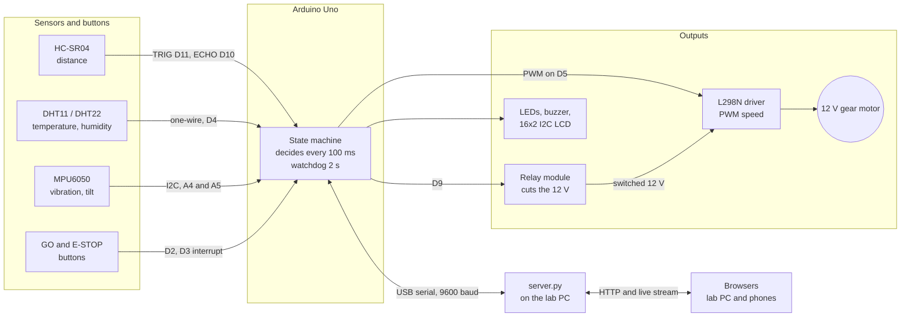
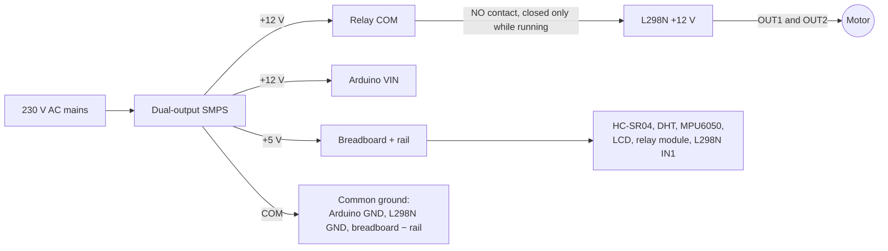
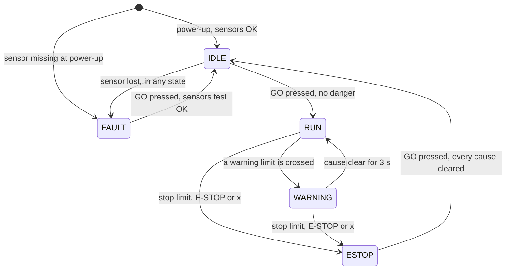
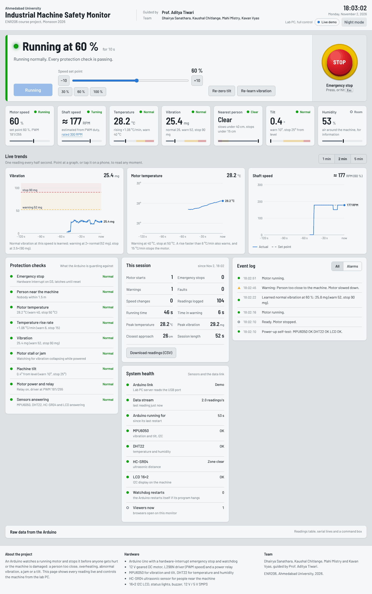
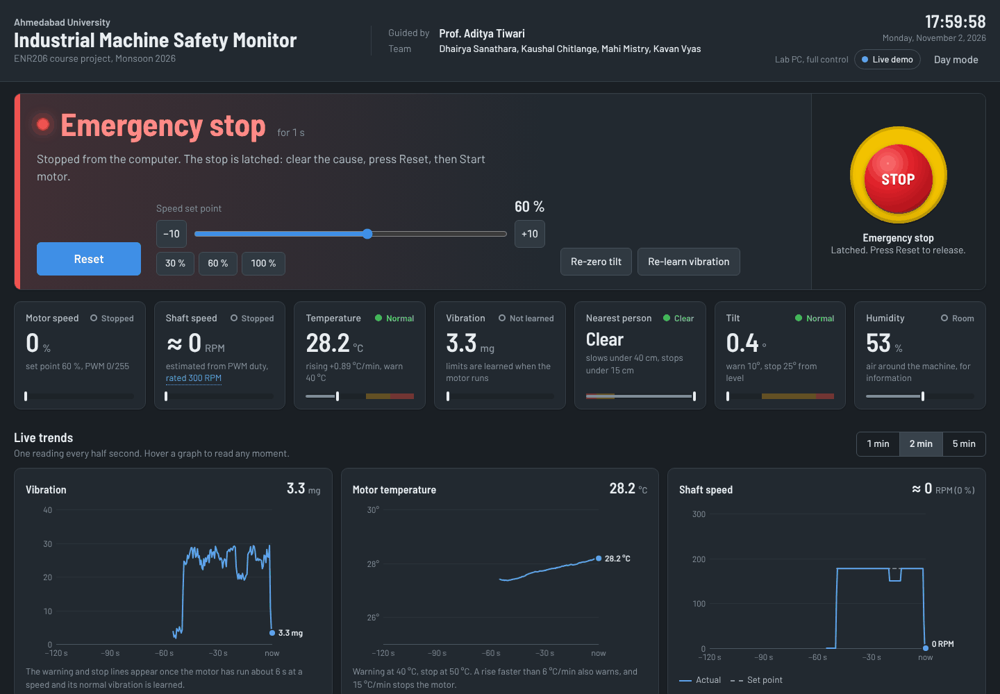
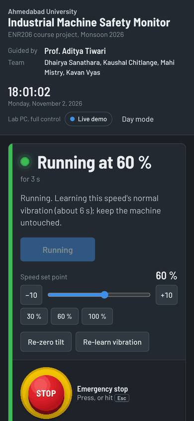

# Industrial Machine Safety Monitor


An Arduino Uno guards a running 12 V motor. It watches for a person coming too close, overheating, abnormal
vibration, a tilted machine and a jammed shaft. When something is wrong it slows the motor, and when it is
dangerous it cuts the power and keeps it off until a person resets it. A live web dashboard controls the
machine from the lab PC and lets anyone on the same Wi-Fi watch it, and press emergency stop, from a phone.

**ENR206 course project, Ahmedabad University (Monsoon 2026)**
Guided by **Prof. Aditya Tiwari**
Team: **Dhairya Sanathara, Kaushal Chitlange, Mahi Mistry, Kavan Vyas**



---

## Contents

- [What it protects against](#what-it-protects-against)
- [Highlights](#highlights)
- [System architecture](#system-architecture)
- [Hardware](#hardware)
- [Wiring at a glance](#wiring-at-a-glance)
- [How the controller decides](#how-the-controller-decides)
- [Getting started](#getting-started)
- [Commands](#commands)
- [Web dashboard](#web-dashboard)
- [Repository layout](#repository-layout)
- [Documentation](#documentation)
- [Limitations](#limitations)
- [Team](#team)
- [License](#license)

---

## What it protects against

| Hazard | Sensor | Warning (motor slows to 45 %) | Emergency stop (power cut, latched) |
| --- | --- | --- | --- |
| Person too close | HC-SR04 ultrasonic | Closer than 40 cm | Closer than 15 cm |
| Overheating | DHT11 / DHT22 | 40 °C | 50 °C |
| Temperature rising fast | DHT, slope over the last ~30 s | 6 °C per minute | 15 °C per minute |
| Abnormal vibration | MPU6050 | 2 × the learned normal level | 3.5 × the learned normal level (always above 800 mg) |
| Machine tilted or knocked over | MPU6050 | 10° from its installed position | 25° |
| Motor stalled or jammed | MPU6050 (vibration collapses at steady speed) | | Below 35 % of normal for 1.5 s |
| Sensor lost or frozen | Self-test and continuous checks | | FAULT: the motor will not run |
| Operator command | E-STOP button, website, any phone | | Immediate |

## Highlights

- **Learned vibration limits.** The first time the motor runs at a speed, the controller measures the healthy
  machine for 4 s and sets that speed's limits as multiples of it. Each 10 % speed step has its own baseline.
- **Temperature by level and by rate.** A least-squares line through the last 15 readings gives °C/min, so a
  fast-heating fault is caught before the absolute limit.
- **Stall detection without a current sensor.** A turning motor always vibrates; a collapse in vibration at a
  steady speed means the shaft has stopped.
- **Layered fail-safe design.** Energise-to-run relay, emergency stop on a hardware interrupt, 2 s watchdog,
  latching stop with a first-out reason, no auto-start, and sensors checked at power-up and while running.
- **Two independent ways to cut the motor.** The L298N stops driving it and the relay physically opens its
  12 V supply.
- **Non-blocking firmware.** A `millis()` scheduler runs the safety decision every 100 ms and samples vibration
  at 100 Hz; nothing ever waits in `delay()`.
- **Live web HMI.** A Python server bridges USB serial to every browser: big state banner, seven live values,
  three trend graphs, protection checks, session counters, event log and CSV logging. Only the lab PC can start
  the machine; any viewer can stop it.

## System architecture



The PC only exchanges data over USB. Every safety decision is made on the Arduino, so the machine stays safe if
the PC crashes or the cable is pulled.

## Hardware

| Component | Qty | Role | Interface |
| --- | --- | --- | --- |
| Arduino Uno R3 (ATmega328P) | 1 | Controller | — |
| Dual-output SMPS, 230 V AC to 12 V and 5 V | 1 | Power for everything | — |
| 12 V DC geared motor | 1 | The "machine" | Driven by the L298N |
| L298N dual H-bridge module | 1 | Motor speed (PWM on ENA) | D5 (also mirrored on D6) through 10 kΩ |
| 5 V single-channel relay module (SRD-05VDC) | 1 | Hard power switch for the motor's 12 V | D9, active-low |
| HC-SR04 ultrasonic sensor | 1 | Distance to a person | TRIG D11, ECHO D10 |
| DHT22 or DHT11 | 1 | Air temperature and humidity at the motor | One-wire on D4 |
| MPU6050 (GY-521) | 1 | Vibration RMS and tilt | I2C (0x68) |
| 16×2 LCD with PCF8574 I2C backpack | 1 | Local status display | I2C (0x27 or 0x3F) |
| Push buttons | 2 | GO (start / reset), E-STOP | D2, D3 (interrupt) |
| LEDs: green, yellow, red, with 220 Ω | 3 | Safe, warning, stopped | A0, A1, A2 |
| Active buzzer | 1 | Warning beeps and stop alarm | D8 |
| 10 kΩ resistor, 100 nF capacitor | 1 each | ENA protection; motor noise suppression | — |

Every part is explained in [docs/components](docs/components): what it does, the physics behind it, how it is
wired here and why.

## Wiring at a glance

| Arduino pin | Connected to | Signal |
| --- | --- | --- |
| D2 | GO button to GND | Digital in, internal pull-up |
| D3 | E-STOP button to GND | Digital in, external interrupt INT1 |
| D4 | DHT data | One-wire, timed pulses |
| D5 (and D6) | L298N ENA through 10 kΩ | PWM, about 977 Hz |
| D8 | Active buzzer + | Digital out |
| D9 | Relay module IN | Digital out, active-low |
| D10 | HC-SR04 ECHO | Pulse width = echo time |
| D11 | HC-SR04 TRIG | 10 µs pulse |
| A0, A1, A2 | Green, yellow, red LEDs through 220 Ω | Digital out |
| A4 (SDA), A5 (SCL) | MPU6050 and LCD backpack | I2C, 100 kHz |
| VIN | SMPS +12 V | Power in |
| GND | Common ground rail | 0 V reference |



L298N IN1 goes to +5 V and IN2 to GND, so the motor always turns one way; the Arduino controls only power (relay)
and speed (ENA). The full connection list, assembly order and checks are in [docs/wiring.md](docs/wiring.md).

## How the controller decides



| State | Motor | Lights and sound |
| --- | --- | --- |
| IDLE | Off, relay open, ready | Green blinking (yellow too if a danger is present) |
| RUN | At the set speed | Green; fast blink while learning the vibration baseline |
| WARNING | Slowed to 45 % | Yellow, a short beep every second |
| ESTOP | Off, relay open, **latched** | Red flashing with alarm while the danger is present; steady red with a chirp every 2 s once GO can reset it |
| FAULT | Off; a sensor is missing or frozen | Red and yellow alternating, a chirp every 3 s |

**Safety layers**

1. The relay is energise-to-run: no power, a reset or a broken wire means no motor.
2. The E-STOP button is on a hardware interrupt, so the motor is cut within microseconds.
3. A 2 s watchdog restarts a frozen program, which drops the relay (layer 1).
4. Stops are latched with a first-out reason and never restart by themselves.
5. No auto-start at power-up; GO is refused while a danger is present.
6. Sensors are checked at start-up and continuously; an I2C bus jam cannot freeze the loop (25 ms time-out).

More in [docs/firmware.md](docs/firmware.md).

## Getting started

### 1. Wire it

Follow [docs/wiring.md](docs/wiring.md) with the SMPS switched off. Check the common ground before power-up.

### 2. Upload the firmware

1. Install the Arduino IDE.
2. *Tools → Manage Libraries*, install:
   - **LiquidCrystal I2C** by Frank de Brabander
   - **DHT sensor library** by Adafruit (accept **Adafruit Unified Sensor**)
3. Open `firmware/machine_safety_v2/machine_safety_v2.ino`, choose *Arduino Uno*, upload.
4. Open the Serial Monitor at **9600 baud**: a readable report appears every 2 s.

The MPU6050 is read straight from its registers, so it needs no library. Settings (pins, limits, relay polarity)
are at the top of the sketch. New hardware? Bring it up part by part with the sketches in
[firmware/tests](firmware/tests).

### 3. Start the dashboard

```bash
cd web
python -m pip install pyserial
python server.py              # finds the Arduino by itself
python server.py --port COM11 # or name the port
```

On Windows, double-click `web/start_monitor.bat`. The browser opens at **http://localhost:8000**. Phones on the
same Wi-Fi can open the address printed in the server window. Close the Arduino IDE's Serial Monitor first: only
one program can use the port.

No hardware? `python server.py --demo` runs a pretend machine that sends exactly the same data.

The page shows the university logo if you place the official file next to `index.html` as `au_logo.png`
(not included in this repository).

## Commands

Type these in the Serial Monitor (9600 baud, any line ending) or the website's command box.

| Command | Action |
| --- | --- |
| `g` | GO: start, or reset after a stop |
| `x` | Emergency stop |
| `10` … `100` + Enter | Speed set point in %, steps of 10 |
| `+` / `-` | Speed ±10 % |
| `s` | Status report in plain words |
| `z` | Re-zero tilt (current position = level) |
| `l` | Forget the learned vibration baselines and learn again |
| `n` | Readable text report every 2 s (default) |
| `d` | CSV data for the dashboard, every 0.5 s |
| `v` / `t` / `b` | Serial Plotter graphs: vibration / temperature / both |
| `?` | Help |

The data format is documented in [docs/serial-protocol.md](docs/serial-protocol.md).

## Web dashboard

| Day mode | Emergency stop | Phone |
| --- | --- | --- |
|  |  |  |

- Machine state banner with Start/Reset, speed set point and a large emergency-stop button (also the **Esc** key).
- Seven live tiles: speed, estimated shaft RPM, temperature and rise rate, vibration, nearest person, tilt,
  humidity, each with its warning and stop zones.
- Three live graphs (1, 2 or 5 minutes) with the learned and fixed limits drawn in.
- Protection checks, session counters (starts, stops, warnings, running time, peaks), system health and an event
  log.
- Every reading saved to `web/data/session_<date>.csv`; raw serial lines and a command box.
- Only the lab PC (`localhost`) can start the machine or change speed; any viewer can press emergency stop.

Details: [web/README.md](web/README.md).

## Repository layout

```
.
├── firmware/
│   ├── machine_safety_v2/        main program for the Arduino Uno
│   └── tests/                    one small sketch per part, for bring-up and debugging
├── web/
│   ├── server.py                 USB serial to web bridge, live stream, logging
│   ├── index.html                the dashboard (single page)
│   ├── start_monitor.bat         Windows launcher
│   └── start_demo.bat            launcher with the demo machine
└── docs/
    ├── components/               how every part works and how it is wired here
    ├── wiring.md                 full connection list and assembly order
    ├── firmware.md               scheduler, state machine, safety logic
    ├── serial-protocol.md        H / L / D / E line formats
    ├── calculations.md           worked numbers behind every setting
    ├── testing.md                bring-up order, test sketches, problems we solved
    ├── limitations-and-future-work.md
    └── images/
```

## Documentation

| Topic | File |
| --- | --- |
| Arduino Uno | [docs/components/arduino-uno.md](docs/components/arduino-uno.md) |
| SMPS and power distribution | [docs/components/smps-power-supply.md](docs/components/smps-power-supply.md) |
| Relay module | [docs/components/relay-module.md](docs/components/relay-module.md) |
| L298N motor driver and PWM | [docs/components/l298n-motor-driver.md](docs/components/l298n-motor-driver.md) |
| 12 V DC gear motor | [docs/components/dc-gear-motor.md](docs/components/dc-gear-motor.md) |
| HC-SR04 ultrasonic sensor | [docs/components/hc-sr04-ultrasonic.md](docs/components/hc-sr04-ultrasonic.md) |
| DHT11 / DHT22 | [docs/components/dht11-dht22.md](docs/components/dht11-dht22.md) |
| MPU6050 | [docs/components/mpu6050.md](docs/components/mpu6050.md) |
| I2C bus and 16×2 LCD | [docs/components/i2c-bus-and-lcd.md](docs/components/i2c-bus-and-lcd.md) |
| Buttons, LEDs and buzzer | [docs/components/buttons-leds-buzzer.md](docs/components/buttons-leds-buzzer.md) |
| Wiring | [docs/wiring.md](docs/wiring.md) |
| Firmware design | [docs/firmware.md](docs/firmware.md) |
| Serial protocol | [docs/serial-protocol.md](docs/serial-protocol.md) |
| Calculations | [docs/calculations.md](docs/calculations.md) |
| Testing and troubleshooting | [docs/testing.md](docs/testing.md) |
| Limitations and future work | [docs/limitations-and-future-work.md](docs/limitations-and-future-work.md) |

## Limitations

This is a teaching prototype, not a certified safety system. The Arduino is not safety-rated, the E-STOP is a
normally open push button read by the microcontroller, RPM is estimated from PWM rather than measured, and the
DHT measures the air next to the motor rather than its windings. The full list, and what we would build next, is
in [docs/limitations-and-future-work.md](docs/limitations-and-future-work.md).

## Team

| | |
| --- | --- |
| Course | ENR206, School of Engineering and Applied Science, Ahmedabad University, Monsoon 2026 |
| Guide | Prof. Aditya Tiwari |
| Team | Dhairya Sanathara, Kaushal Chitlange, Mahi Mistry, Kavan Vyas |

## License

[MIT](LICENSE)
