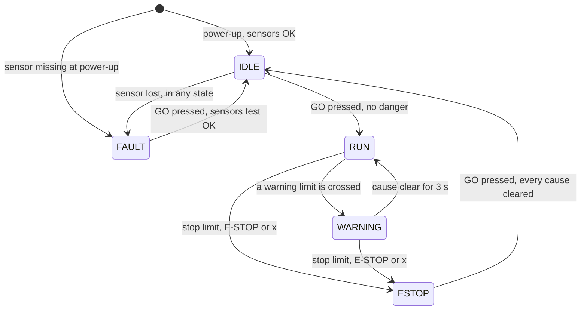

# Firmware design

`firmware/machine_safety_v2/machine_safety_v2.ino` is a state machine driven by a non-blocking scheduler.
Nothing waits: each task checks whether its time has come and returns at once, and the safety decision runs every
100 ms.

## Scheduler

| Task | Runs every | What it does |
| --- | --- | --- |
| E-stop flag, buttons, watchdog reset | Every pass of `loop()` | React to the interrupt; debounce GO; prove the program is alive |
| MPU6050 sample | 10 ms | One acceleration reading; every 50th completes a vibration and tilt result |
| Motor ramp | 10 ms | Move the PWM 5 steps toward its target |
| Ultrasonic ping | 70 ms | One ping (waits at most 10 ms), median of the last three |
| Safety logic | 100 ms | Compare every value with its limits and choose the state |
| LCD | 250 ms | Redraw; the second line changes page every 2 s |
| Serial data row | 500 ms | One CSV row in data mode (a readable report every 2 s in text mode) |
| Temperature | 2.1 s | One DHT reading and the new rise rate |

**Why not `delay()`?** It freezes everything. Waiting 2 s for the DHT inside `delay()` would leave a person in
front of the machine unchecked for 2 s. With `millis()`, each task compares "now − last run" with its period;
unsigned subtraction keeps working when `millis()` rolls over after 49.7 days.

## States



- **IDLE:** motor off, relay open. GO starts the motor only if no danger is present and every sensor is healthy.
- **RUN:** motor at the set speed.
- **WARNING:** the motor slows to 45 % (or stays lower) and returns to RUN only after the cause has been clear
  for 3 s.
- **ESTOP:** the relay opens and the state is latched. GO resets to IDLE only once every cause has cleared.
- **FAULT:** a sensor is missing, frozen or not answering; GO tests the sensors again.

## Limits

| Check | Warning | Stop | Hysteresis / filter |
| --- | --- | --- | --- |
| Distance | < 40 cm | < 15 cm | Clears beyond 45 cm; median of 3 pings |
| Temperature | 40 °C | 50 °C | 2 °C |
| Temperature rise | 6 °C/min | 15 °C/min | 1.5 °C/min |
| Vibration | max(2 × baseline, 40 mg) | max(3.5 × baseline, 1.5 × warning); always 800 mg | Over the stop limit for 1 s |
| Tilt | 10° | 25° | 2° |
| Stall | | Vibration < 35 % of baseline at steady speed | Lasts 1.5 s; baseline ≥ 15 mg |
| Start-up | | | First 2 s after a start ignored (spin-up) |

**Priority and first-out.** Reasons have a fixed priority (emergency button, remote stop, relay, power, sensor
faults, proximity, overload, stall, temperature, rise rate, vibration, tilt). The first reason that tripped is
latched and shown: a jam can cause high vibration a moment later, and the first cause is the one to fix.

**Hysteresis** stops a value hovering at a limit from flipping the state many times a second (chatter).

## Learned vibration limits

A motor shakes less at 40 % than at 100 %, and every machine is mounted differently, so a fixed limit would be too
loose at low speed or too tight at high speed. After the 2 s spin-up at a new speed, 8 windows (4 s) are averaged
into a baseline for that 10 % speed step. Baselines are kept until power-off or the `l` command, so a fault that
develops later is still compared with the healthy machine. A `BASELINE` event reports each one.

## Stall detection without a current sensor

At a steady running speed a turning motor always vibrates. If vibration falls below 35 % of that speed's baseline
for 1.5 s while the PWM is at its running value, the shaft has stopped: emergency stop with reason `STALL`.

## Temperature rise rate

The rate is the least-squares slope of the last 15 readings (about 31 s), with x the reading number and y the
temperature:

```
m = (n Σxy − Σx Σy) / (n Σx² − (Σx)²)        rate = m × 60 / 2.1   °C per minute
```

One noisy reading barely moves a fitted line, while "last minus first" would jump.

## Interrupts and race conditions

- The E-STOP ISR cuts the PWM, drops the relay and sets a flag, in microseconds; logging and the display happen
  later in the loop.
- The flag is `volatile`, so the compiler re-reads it from memory instead of trusting a stale register copy.
- The ISR and the loop both write the motor outputs. The loop's writes run inside `noInterrupts()` …
  `interrupts()`, so the ISR cannot land between "check the flag" and "switch the motor on".
- Multi-byte values shared with an ISR are copied with interrupts off: an 8-bit CPU reads a 32-bit number in four
  steps and could otherwise read half old, half new.

## Fail-safe layers

1. The relay is energise-to-run: no power, a reset or a broken wire means no motor.
2. The E-STOP button is a hardware interrupt.
3. A 2 s watchdog restarts a frozen program (back to layer 1).
4. Stops are latched with a first-out reason.
5. No auto-start at power-up; GO is refused while a danger is present.
6. Sensors are checked at start-up (lamp test, self-test) and continuously: a missing or frozen MPU6050 or a
   failing DHT causes a FAULT, and `Wire.setWireTimeout()` stops a jammed I2C bus from freezing the loop.

## Memory

The program uses 31,880 of 32,256 bytes of flash and 1,299 of 2,048 bytes of SRAM. Fixed text lives in flash
(`F()`, `PROGMEM`), and the optional INA219 current sensor and 12 V sense code are compiled out
(`HAS_INA219 0`, `HAS_12V_DIVIDER 0`). Serial output never blocks: a row is built in a buffer and only as many
bytes are sent as `Serial.availableForWrite()` allows, so the loop never waits for the 9600-baud line.
