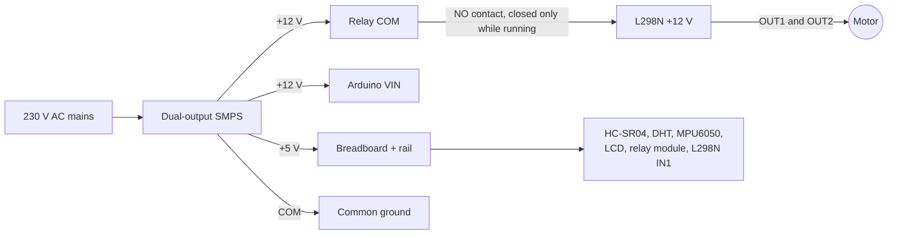

# Wiring

Do all wiring with the SMPS unplugged. Every ground (SMPS COM, Arduino GND, L298N GND, breadboard − rail) must be
joined: every signal is a voltage measured against that one reference.

## Power

| From | To | Notes |
| --- | --- | --- |
| Mains cable | SMPS L, N, earth | 3-pin plug; earth on the metal case; cover the terminals |
| SMPS +12 V | Relay COM | The motor's supply goes through the relay contact |
| SMPS +12 V | Arduino VIN | Through the board's own regulator |
| SMPS +5 V | Breadboard + rail | Sensors, LCD, relay module, L298N IN1 |
| SMPS COM | Breadboard − rail and L298N GND | Common ground |
| Arduino GND | Breadboard − rail | Common ground |
| Arduino 5V pin | Not used | The SMPS 5 V rail feeds the sensors |

## Motor chain

| From | To | Notes |
| --- | --- | --- |
| Relay VCC | + rail | |
| Relay GND | − rail | |
| Relay IN | Arduino D9 | Active-low: LOW = relay on |
| Relay COM | SMPS +12 V | |
| Relay NO | L298N +12 V | 12 V reaches the driver only while the relay is on |
| L298N GND | SMPS COM | |
| L298N 5V terminal | Nothing | Output while the 12V-EN jumper is on |
| L298N 12V-EN jumper | Keep ON | The module makes its own 5 V logic supply |
| L298N ENA jumper cap | **Remove** | Otherwise ENA is always HIGH (full speed) |
| L298N ENA pin | 10 kΩ resistor → Arduino D5 | D6 carries the same PWM; either works |
| L298N IN1 | + rail (5 V) | Fixed direction |
| L298N IN2 | − rail | Fixed direction |
| L298N OUT1, OUT2 | Motor | Swap to reverse; 100 nF ceramic capacitor across the motor terminals |

## Sensors and display

| Part | Pin | To |
| --- | --- | --- |
| HC-SR04 | VCC, GND | + rail, − rail |
| | TRIG | D11 |
| | ECHO | D10 |
| DHT11 / DHT22 | +, − | + rail, − rail |
| | DATA | D4 (bare 4-pin sensor: 10 kΩ from DATA to + rail) |
| MPU6050 (GY-521) | VCC, GND | + rail, − rail |
| | SCL, SDA | A5, A4 |
| | XDA, XCL, AD0, INT | Not connected |
| LCD I2C backpack | VCC, GND | + rail, − rail |
| | SCL, SDA | A5, A4 (shared with the MPU6050) |

Fix the MPU6050 to the same base as the motor, or it cannot feel the motor.

## Controls and signals

| Part | Connection |
| --- | --- |
| GO button | D2 ↔ − rail (internal pull-up, no resistor) |
| E-STOP button | D3 ↔ − rail (internal pull-up, interrupt pin) |
| Green LED | A0 → 220 Ω → long leg; short leg → − rail |
| Yellow LED | A1 → 220 Ω → long leg; short leg → − rail |
| Red LED | A2 → 220 Ω → long leg; short leg → − rail |
| Active buzzer | + → D8, − → − rail |

Not used: D0 and D1 (USB serial), D7, D12, D13, A3.

## Settings that must match your hardware

At the top of `firmware/machine_safety_v2/machine_safety_v2.ino`:

| Setting | Default | Change it if |
| --- | --- | --- |
| `PIN_RELAY` | 9 | Your relay wire is on another pin |
| `ENA_PIN` | 5 | ENA is on 6, 10 or 11 (the ultrasonic pins move automatically) |
| `RELAY_ACTIVE_LOW` | true | The relay does not click (some modules are active-high) |
| `BUZZER_ACTIVE_LOW` | false | You have a "low level trigger" buzzer module |
| `ESTOP_BUTTON_IS_NC` | false | You fit a real normally closed mushroom E-stop |
| `PWM_MIN` | 70 | The motor only hums at 10 % (raise to 80 or 90) |
| `HAS_INA219`, `HAS_12V_DIVIDER` | 0 | You fit the optional current sensor or 12 V sense divider (one at a time; flash is nearly full) |

## Before the first power-up

1. Unplug USB and mains. Check every ground goes to the − rail.
2. Check nothing from the 12 V side touches an Arduino pin except VIN.
3. Check the ENA jumper cap is off and the 12V-EN jumper is on.
4. Plug in USB only, upload, and watch the lamp test and the self-test line in the Serial Monitor.
5. Then switch on the SMPS and press GO.
